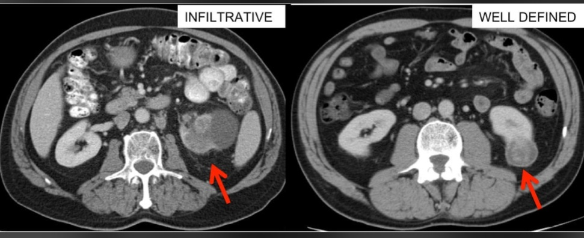

# 🩺 نظام تشخيص أمراض الكلى الذكي باستخدام الشبكات العصبية الالتفافية
# Advanced Kidney CT Scan Multi-Class Classification Framework

---

## 🌟 نبذة عن المشروع (Project Overview)
نظام تشخيصي متكامل يعتمد على تقنيات الرؤية الحاسوبية (**Computer Vision**) والتعلم العميق (**Deep Learning**)، تم تطويره خصيصاً لتحليل ومعالجة صور الأشعة المقطعية (**CT Scans**) للكلى وتصنيفها فورياً بدقة عالية، مما يسهم في دعم القرار الطبي والتشخيص المبكر للآفات والأورام.

---

## 💻 رابط ملف التدريب البرمجي (Training Script)
يمكن الاطلاع على كود تدريب النموذج كاملاً ومستقلاً مباشرة من الرابط التالي:
🔗 **[رابط ملف التدريب (training.py)](https://github.com/abdulrahmanbatool577-create/Batool---j99/blob/main/training.py)**

---

## 📊 كفاءة النموذج وأداء التشخيص (Model Benchmark & Metrics)

* **دقة التدريب والتقييم (Model Accuracy):** `93%`
* **نسبة الثقة في الاختبار الحقيقي (Live Prediction Confidence):** `93.42%` (تشخيص مؤكد لفئة الأورام).
* **نموذج التصنيف (Model Architecture):** Deep Convolutional Neural Network (VGG16 / CNN).
* **عدد الفئات المستهدفة:** 4 فئات تشخيصية دقيقة.

---

## 🎯 الفئات التشخيصية المستهدفة (Diagnostic Taxonomy)

1. **أورام الكلى (Kidney Tumor):** الكشف المبكر عن الأنسجة والمساحات الخبيثة أو الحميدة.
2. **تكيسات الكلى (Kidney Cyst):** رصد أكياس السوائل وتحديد مواقعها.
3. **حصوات الكلى (Kidney Stone):** التنبؤ بوجود الحصوات البرية وتحديدها.
4. **الكلى السليمة (Normal Kidney):** التأكد من سلامة الأنسجة والخلو من الأمراض.

---

## 📊 واجهة التطبيق ونتيجة الفحص (UI Preview)

توضح الصورة أدناه الواجهة التفاعلية للنظام مع نتيجة فحص حقيقية لورم مع نسبة ثقة عالية:



---

## 🛠️ التقنيات والمكتبات المستخدمة (Tech Stack)

* **لغة البرمجة:** Python 3.10
* **إطار التعلم العميق:** TensorFlow / Keras
* **النموذج الأساسي:** VGG16 Architecture
* **واجهة المستخدم:** Gradio Web Interface
* **معالجة الصور والبيانات:** NumPy, OpenCV, Data Augmentation

---

## 🚀 طريقة تشغيل المشروع محلياً (Setup & Installation)

1. **استنساخ المستودع:**
   ```bash
   git clone [https://github.com/abdulrahmanbatool577-create/Batool---j99.git](https://github.com/abdulrahmanbatool577-create/Batool---j99.git)
   cd Batool---j99
